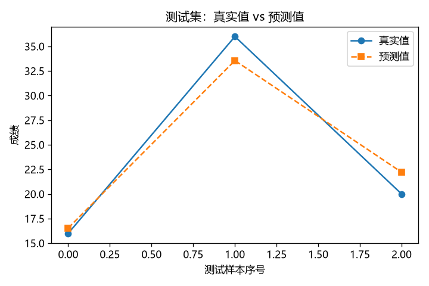

# 第五课：回归评价指标——MAE、MSE、RMSE 与 R²

## 【本节核心知识点】
用 MAE、MSE、RMSE、R² 四把尺子给回归模型的"猜得准不准"打分：前三个**误差越小越好**，R² **越接近 1 越好**，并且成绩以**测试集**为准。

## 【核心概念讲解】

第一课训完模型，我们只"看"了两条预测值对不对。可真实任务里数据成千上万条，肉眼看不过来——需要**用一个数字回答"这个模型好不好"**，这个数字就是**评价指标**。

先约定一个名字：每个样本的**误差**（也叫残差，residual（残差））= 预测值 − 真实值，记作 $\hat{y} - y$。误差有正有负（猜高了为正、猜低了为负），直接取平均会正负抵消，所以四把尺子都先"消化"掉符号。

### 四把尺子的通俗解释

| 指标 | 通俗解释 | 好的方向 | 单位 |
|---|---|---|---|
| **MAE**（平均绝对误差） | 把每个误差取绝对值（正负号去掉）再求平均——"平均差了几分" | 越小越好 | 和 y 相同（分） |
| **MSE**（均方误差） | 每个误差先**平方**再平均——平方会重罚大误差 | 越小越好 | y 的平方（分²） |
| **RMSE**（均方根误差） | 把 MSE 再开根号——回到"分"这个单位 | 越小越好 | 和 y 相同（分） |
| **R²**（决定系数） | 模型比"闭眼猜平均值"好多少，满分 1 | 越接近 1 越好 | 没单位 |

公式（看不懂先跳过，用代码更直观）：

$$MAE = \frac{1}{n}\sum_{i=1}^{n}|\,y_i - \hat{y}_i\,|, \quad MSE = \frac{1}{n}\sum_{i=1}^{n}(y_i - \hat{y}_i)^2, \quad RMSE = \sqrt{MSE}$$

$$R^2 = 1 - \frac{SS_{res}}{SS_{tot}} = 1 - \frac{\sum(y_i - \hat{y}_i)^2}{\sum(y_i - \bar{y})^2}$$

其中 $\bar{y}$ 是真实值的平均值，$SS_{res}$ 是"模型的误差平方和"，$SS_{tot}$ 是"闭眼全猜平均值的误差平方和"。所以 **R² 的含义**：

- $R^2 = 1$：完美，一点误差没有；
- $R^2 = 0$：跟闭眼猜平均值（baseline（基线））一样烂；
- $R^2 < 0$：**比闭眼猜平均值还烂**（可能吗？可能，比如拿直线硬套明显是曲线的数据）。

### MSE 为什么要平方？

平方有两个作用：① 把负误差变正，解决正负抵消；② **放大（重罚）大误差**——差 10 分平方变 100，差 1 分才变 1。如果你的业务里"错得离谱"特别不能忍（比如房价预测差 100 万），看 MSE/RMSE 比看 MAE 更有感觉。

### 训练集指标 vs 测试集指标

老规矩：**测试集的成绩才算数**。训练集指标几乎总是更好看（模型就是在它身上学的），拿训练集分数汇报 = 自欺欺人。两者差得越远，越要警惕**过拟合**（死记训练数据、不会举一反三）。

### 工具一句话

打分函数都在 sklearn 的 `sklearn.metrics` 里；画对比图用 **matplotlib**（Python 最常用的画图库），本课第一次用，逐行注释里讲。

## 【核心内置函数拆解】

### ① `mean_absolute_error(y_true, y_pred)` — MAE
- **作用**：算平均绝对误差——"平均差了多少"。
- **完整语法**：`mean_absolute_error(y_true, y_pred, sample_weight=None)`
- **关键参数**：`y_true` —— 真实值，一维数组；`y_pred` —— 预测值，一维数组；`sample_weight` —— 样本权重，入门不用。
- **返回值**：一个浮点数（float），如 `2.3333333333333335`。
- **常见坑**：⚠️ **`y_true` 在前、`y_pred` 在后**，顺序别传反（数值上碰巧对称，但读代码的人会误解）；两个数组**长度必须相等**，不等直接报 `ValueError`。
- **适用场景**：想要一个"和 y 同单位、好解释"的误差——"平均差 1.73 分"。

### ② `mean_squared_error(y_true, y_pred)` — MSE
- **作用**：算均方误差——平方后平均，重罚大误差。
- **完整语法**：`mean_squared_error(y_true, y_pred, sample_weight=None)`
- **关键参数**：同①。
- **返回值**：一个浮点数，单位是"y 单位的平方"。
- **常见坑**：⚠️ 网上旧教程常写 `mean_squared_error(..., squared=False)` 来求 RMSE——**新版 sklearn 已删掉 `squared` 参数，会报错**，请直接用③。
- **适用场景**：想特别惩罚"错得离谱"的样本时。

### ③ `root_mean_squared_error(y_true, y_pred)` — RMSE
- **作用**：算均方根误差 = √MSE，把单位从"平方"拉回"原单位"。
- **完整语法**：`root_mean_squared_error(y_true, y_pred, sample_weight=None)`
- **关键参数**：同①。
- **返回值**：一个浮点数，和 y 同单位。
- **常见坑**：别和②搞混——MSE 平方了没开根号，RMSE 开了根号；RMSE ≥ MAE 恒成立（数学性质，可以拿来粗查代码）。
- **适用场景**：汇报"平均差几分"，又想保留对大误差的惩罚——**最常用的汇报指标**。

### ④ `r2_score(y_true, y_pred)` — R²
- **作用**：算决定系数 R²——"比闭眼猜平均值好多少"。
- **完整语法**：`r2_score(y_true, y_pred, sample_weight=None)`
- **关键参数**：同①。
- **返回值**：一个浮点数，通常 ≤ 1，可能为负。
- **常见坑**：⚠️ R² 也能为负，别看到负数以为函数坏了——是模型真比"全猜平均值"还差；另外**样本少于 2 个会报错**（算不了平均值）。
- **适用场景**：想用一个 0~1 的分数横向比较不同模型。

### ⑤ `model.score(X, y)` — 模型自带打分
- **作用**：训练好的线性回归模型自带的打分方法，**回归问题下返回的就是 R²**。
- **完整语法**：`model.score(X, y)`
- **关键参数**：`X` —— 二维特征；`y` —— 对应真实标签。
- **返回值**：浮点数，和 `r2_score(y, model.predict(X))` 完全相等。
- **常见坑**：X、y 必须是**同一份数据**（都是测试集或都是训练集），混着传分数没有意义。
- **适用场景**：只要 R²、懒得 import 指标函数时的快捷写法。

## 【完整代码示例 + 逐行注释】

```python
# ============ 第五课：回归评价指标 MAE / MSE / RMSE / R² ============
import numpy as np                        # 数组工具
import pandas as pd                       # 表格工具（只用来把结果摆成对照表）
from sklearn.model_selection import train_test_split   # 划分训练集/测试集
from sklearn.linear_model import LinearRegression      # 线性回归模型
from sklearn.metrics import (                          # 四个评价指标函数
    mean_absolute_error,        # 函数①：MAE
    mean_squared_error,         # 函数②：MSE
    root_mean_squared_error,    # 函数③：RMSE
    r2_score,                   # 函数④：R²
)
import matplotlib
matplotlib.use('Agg')                     # 无界面环境也能画图（只存文件不弹窗）
import matplotlib.pyplot as plt           # 画图工具
plt.rcParams['font.sans-serif'] = ['Microsoft YaHei', 'SimHei']  # 中文字体，防止中文变方框
plt.rcParams['axes.unicode_minus'] = False                     # 负号正常显示

# ---------- 第一部分：小例子，手算对照 ----------
print('===== 第一部分：3 个样本的手算对照 =====')
y_true = np.array([10, 20, 30])           # 真实值
y_pred = np.array([12, 18, 33])           # 预测值（故意猜得有偏差）

print('MAE  =', mean_absolute_error(y_true, y_pred))    # 函数①
print('MSE  =', mean_squared_error(y_true, y_pred))     # 函数②
print('RMSE =', root_mean_squared_error(y_true, y_pred))# 函数③
print('R2   =', r2_score(y_true, y_pred))               # 函数④

# ---------- 第二部分：接回线性回归全流程 ----------
print()
print('===== 第二部分：学时 → 成绩，测试集上打分 =====')
x_raw = np.array([1, 2, 3, 4, 5, 6, 7, 8, 9, 10])       # 学习时长
y = np.array([11, 12, 16, 21, 20, 26, 28, 30, 36, 36])  # 成绩（在 y=3x+7 上下波动）
X = x_raw.reshape(-1, 1)                                # 转成二维（第一课函数②）

X_train, X_test, y_train, y_test = train_test_split(
    X, y, test_size=0.3, random_state=0                 # 7 训练 / 3 测试
)

model = LinearRegression()              # 造模型
model.fit(X_train, y_train)             # 只用训练集学习

y_pred_test = model.predict(X_test)     # 对测试集 3 个样本做预测

# 把测试集的真实值 / 预测值 / 误差摆成一张表（误差 = 预测值 - 真实值）
tab = pd.DataFrame({
    '真实值': y_test,
    '预测值': np.round(y_pred_test, 2),   # 保留 2 位小数，方便手算对照
    '误差': np.round(y_pred_test - y_test, 2),
})
print(tab.to_string(index=False))       # to_string(index=False)：不打印行号，输出更干净

print()
print('--- 测试集指标 ---')
print('MAE  =', mean_absolute_error(y_test, y_pred_test))    # 函数①
print('MSE  =', mean_squared_error(y_test, y_pred_test))     # 函数②
print('RMSE =', root_mean_squared_error(y_test, y_pred_test))# 函数③
print('R2   =', r2_score(y_test, y_pred_test))               # 函数④

print()
print('--- 训练集指标（对照用） ---')
y_pred_train = model.predict(X_train)                       # 对训练集也预测一遍
print('训练集 MAE =', mean_absolute_error(y_train, y_pred_train))
print('训练集 R2  =', r2_score(y_train, y_pred_train))
print('model.score(X_test, y_test) =', model.score(X_test, y_test))  # 函数⑤：回归下就是 R²

# ---------- 第三部分：真实值 vs 预测值 对比图 ----------
plt.figure(figsize=(6, 4))                       # 画布大小（6 英寸宽 × 4 英寸高）
plt.plot(y_test, 'o-', label='真实值')           # 圆点+实线画真实值
plt.plot(y_pred_test, 's--', label='预测值')     # 方块+虚线画预测值
plt.title('测试集：真实值 vs 预测值')            # 图标题
plt.xlabel('测试样本序号')                       # 横轴名
plt.ylabel('成绩')                               # 纵轴名
plt.legend()                                     # 显示图例
plt.tight_layout()                               # 自动收紧边距，防止标签被裁掉
plt.savefig('真实vs预测.png', dpi=120)           # 存成图片文件（dpi=清晰度）
print()
print('图片已保存：真实vs预测.png')
```

**真实运行结果**（`.venv` 实测）：

```text
===== 第一部分：3 个样本的手算对照 =====
MAE  = 2.3333333333333335
MSE  = 5.666666666666667
RMSE = 2.3804761428476167
R2   = 0.915

===== 第二部分：学时 → 成绩，测试集上打分 =====
 真实值   预测值    误差
  16 16.54  0.54
  36 33.56 -2.44
  20 22.21  2.21

--- 测试集指标 ---
MAE  = 1.7316890881913285
MSE  = 3.71709833966766
RMSE = 1.9279777850555384
R2   = 0.9502174329508796

--- 训练集指标（对照用） ---
训练集 MAE = 0.805893657911596
训练集 R2  = 0.9862420094813836
model.score(X_test, y_test) = 0.9502174329508796

图片已保存：真实vs预测.png
```

画出来的对比图（和代码同目录的 `真实vs预测.png`）：



### 手算对照（关键一步：数字是公式算出来的，不是玄学）

**第一部分**（3 个样本，误差 = 预测值 − 真实值 = `[12-10, 18-20, 33-30]` = `[2, -2, 3]`）：

| 指标 | 手算过程 | 手算值 | 实测值 | 判定 |
|---|---|---|---|---|
| MAE | (2 + 2 + 3) ÷ 3 = 7 ÷ 3 | 2.3333… | 2.3333333333333335 | ✅ 浮点表示误差 |
| MSE | (2² + 2² + 3²) ÷ 3 = (4+4+9) ÷ 3 = 17 ÷ 3 | 5.6667… | 5.666666666666667 | ✅ 浮点表示误差 |
| RMSE | √(17 ÷ 3) | 2.3805… | 2.3804761428476167 | ✅ |
| R² | ȳ = 20；SS_tot = (10-20)² + (20-20)² + (30-20)² = 200；SS_res = 17；1 − 17÷200 | **0.915** | **0.915** | ✅ 精确命中 |

**第二部分**（测试集 3 个样本，手算用表里保留 2 位小数的值，末位差一点是四舍五入造成的，正常）：

| 指标 | 手算过程（用表中数字） | 手算值 | 实测值 | 判定 |
|---|---|---|---|---|
| MAE | (0.54 + 2.44 + 2.21) ÷ 3 = 5.19 ÷ 3 | 1.73 | 1.7317 | ✅ |
| MSE | (0.54² + 2.44² + 2.21²) ÷ 3 = (0.2916+5.9536+4.8841) ÷ 3 | 3.71 | 3.7171 | ✅ |
| RMSE | √3.71 | 1.93 | 1.9280 | ✅ |
| R² | ȳ = (16+36+20)÷3 = 24；SS_tot = 8²+12²+4² = 224；SS_res ≈ 11.13；1 − 11.13÷224 | 0.9503 | 0.95022 | ✅ |

**两个值得注意的现象**：

1. `model.score(X_test, y_test)` = `0.9502174329508796`，和 `r2_score` **一模一样**——函数⑤不是新指标，只是快捷方式。
2. 训练集 R² = 0.986 > 测试集 R² = 0.950，训练集 MAE = 0.81 < 测试集 MAE = 1.73——**训练集分数总是更好看**，汇报以测试集为准。

## 【课后练习】

**题目：广告投入 → 商品销量，跑通"打分 + 画图"全流程**

数据（10 个月的记录）：广告投入 x（万元）= `[1, 2, 3, 4, 5, 6, 7, 8, 9, 10]`，销量 y（万件）= `[11, 14, 19, 26, 29, 33, 39, 43, 48, 53]`（在 `y = 5x + 5` 上下波动）。

要求（一个 `.py` 文件跑完）：

1. 用 `train_test_split(test_size=0.3, random_state=0)` 划分，打印 `X_train.shape`、`X_test.shape`；
2. `LinearRegression` 只在训练集上 `fit`，对测试集 `predict`；
3. 打印测试集的 **MAE、MSE、RMSE、R²** 四个指标，再用 `model.score(X_test, y_test)` 对照 R²（两者应相等）；
4. 打印「真实值 / 预测值 / 误差」对照表（预测值、误差保留 2 位小数），并**用表里的数字手算一遍 MAE**（写成注释或 print），对照库函数的结果；
5. 画「真实值 vs 预测值」对比图，存成 `广告对比.png`（中文字体那两行设置别漏）。

**验收点**：① 形状 (7, 1) / (3, 1)；② 四个指标齐全、RMSE ≥ MAE；③ `model.score` 和 `r2_score` 数值相等；④ 手算 MAE 和实测 MAE 对上（小数点后 2 位一致算通过）；⑤ 图片里中文正常显示、图例齐全。

> ⚠️ 从本课起：作业必须自己在 `.venv` 里实跑，把**真实输出**贴进下面的【我的练习解答】，不贴的退回重交。

### 我的练习解答

（在此粘贴你的代码和运行结果）

### 我的疑问

（记录没想通的点，会话里问我）

## 【本节重点总结】

1. 误差类指标（MAE / MSE / RMSE）**越小越好**，R² **越接近 1 越好**（0 = 跟闭眼猜平均值一样，负数 = 更差）。
2. MSE 平方重罚大误差，RMSE 开根号回到原单位，所以汇报最常用 RMSE 和 R²。
3. 指标要算在**测试集**上才算数；`model.score` 回归下就是 R² 的快捷方式。
